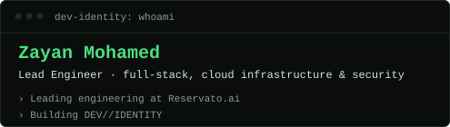
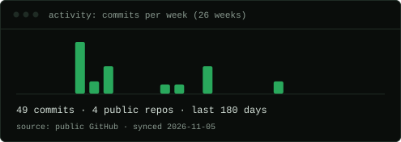
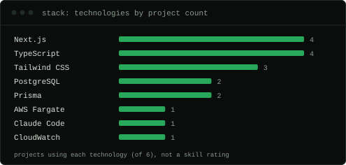

# ZAYAN MOHAMED

### Lead Engineer · full-stack, cloud infrastructure &amp; security

**[Open DEV//IDENTITY →](https://dev-identity-ten.vercel.app)** · [Engineering Observatory](https://dev-identity-ten.vercel.app/observatory)

## WHOAMI

Lead Engineer at Reservato.ai, owning engineering end to end: backend, mobile, web and admin portal, AWS infrastructure, security audits and app releases. Outside Reservato I build marketing and product sites with Next.js and TypeScript, and small tools that make engineering work easier to report on.

**Current focus**

- Leading engineering at Reservato.ai
- Building DEV//IDENTITY

## ENGINEERING ACTIVITY

7 commits across 4 approved public GitHub repositories in the last 90 days \(synchronised 2026-11-11\). [Explore the Observatory](https://dev-identity-ten.vercel.app/observatory)

## FEATURED PROJECTS

- **[Reservato.ai](https://dev-identity-ten.vercel.app/projects/reservato-ai)**
  Restaurant discovery and table-booking platform for Sri Lanka, connecting diners with time-boxed discounts at partner restaurants. Location-based discovery, real-time availability and booking holds, in-app payments, an… *Lead Engineer \(team of 4\): full-stack, infrastructure, security and releases*
- **[Estreia &amp; Meridiano](https://dev-identity-ten.vercel.app/projects/estreia-meridiano)** · [live](https://reserva-estreia.vercel.app) · [source](https://github.com/zayan-work/reserva-estreia)
  A pnpm monorepo with two sites. Estreia is a reservation-list demand test for a Brazilian clothing launch \(deliberately no payments\) with WhatsApp validation and de-duplication, a live reservation counter, a protected d… *Sole developer*
- **[Satinwood Talent](https://dev-identity-ten.vercel.app/projects/satinwood-talent)** · [live](https://satinwood-web.vercel.app) · [source](https://github.com/zayan-work/satinwood-web)
  Marketing site for a firm that embeds senior finance and marketing operators from Sri Lanka. Eleven SEO service landing pages, all copy in JSON edited through Sveltia CMS, and Playwright end-to-end tests for navigation… *Sole developer*

[All projects →](https://dev-identity-ten.vercel.app/?cmd=projects)

## TECHNICAL EXPLORATION

| Technology | Projects |
| --- | ---: |
| Next.js | 4 |
| TypeScript | 4 |
| Tailwind CSS | 3 |
| PostgreSQL | 2 |
| Prisma | 2 |
| AWS Fargate | 1 |
| Claude Code | 1 |
| CloudWatch | 1 |

*Number of public projects using each technology, not a skill rating.*

## ENGINEERING DECISIONS

- [ADR-003](https://dev-identity-ten.vercel.app/decisions/ADR-003): Every system readout must reflect a real check
- [ADR-002](https://dev-identity-ten.vercel.app/decisions/ADR-002): PostgreSQL with Prisma 7
- [ADR-001](https://dev-identity-ten.vercel.app/decisions/ADR-001): pnpm workspaces \+ Turborepo monorepo

## CONTACT

- [github.com/zayan-work](https://github.com/zayan-work)

---

*Generated by DEV//IDENTITY on 2026-11-11 from owner-approved content.*
